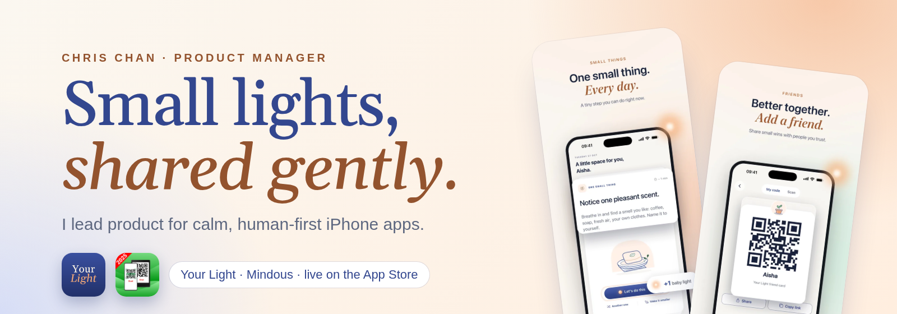

  

# Hi, I'm Chris Chan 👋

**Product Manager** · Kuala Lumpur, Malaysia

- 📱 **[Your Light: Small Steps](https://chanyenqi018-ui.github.io/your-light/)**: a gentle iPhone app for one small thing a day. I am the product manager. Live on the App Store in English, Bahasa Melayu and 简体中文.
- 🎙️ **[Mindous](https://apps.apple.com/my/app/mindous/id6805085913)**: a voice app where three minutes of your real voice tells people what you do. Product manager, live on the App Store.
- 🧭 Product work across fintech (MCash), UI/UX (Hiseven) and B2B software (CADVision).
- 🛠 Product · UX · Agile/Scrum · Figma · Jira

## Find me

| | |
|---|---|
| 🔗 **Links, résumé & portfolio** | [chanyenqi018-ui.github.io](https://chanyenqi018-ui.github.io/) |
| ✨ **Your Light website** | [chanyenqi018-ui.github.io/your-light](https://chanyenqi018-ui.github.io/your-light/) |
| 📲 **Your Light on the App Store** | [Download](https://apps.apple.com/app/your-light-small-steps/id6811325600) |
| 🎨 **Case studies** | [Behance](https://www.behance.net/jordanchanyenqi) |
| 💼 **LinkedIn** | [jordan-chan-yen-qi](https://www.linkedin.com/in/jordan-chan-yen-qi/) |
| 📫 **Email** | [chanyenqi018@gmail.com](mailto:chanyenqi018@gmail.com) |

*Open to Product Manager / Product Owner roles: KL, hybrid or remote.*
